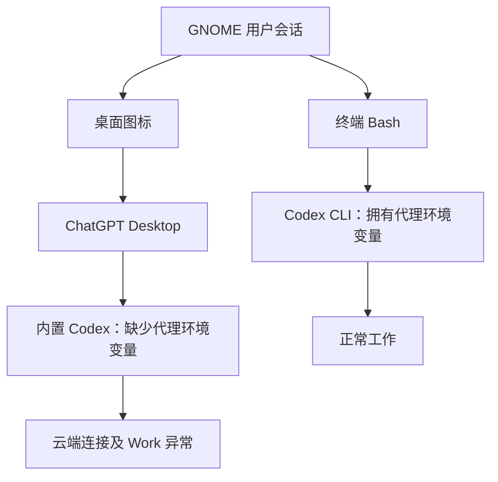

# Ubuntu 22.04 下 ChatGPT Desktop 的 Work 重连与登录异常排查

本文记录在 Ubuntu 22.04 下使用 ChatGPT Desktop 时遇到的一次连接异常，以及如何通过定位桌面应用与终端进程的网络环境差异，修复应用启动配置。

核心问题是：**GNOME 手动代理已经开启，网页版 ChatGPT 和 Codex CLI 可以正常使用，但从桌面图标启动的 ChatGPT Desktop 却无法正常连接云端会话与 Work 服务。**

> 本文为个人实测记录，适用于受支持地区内正常网络环境的客户端代理配置排查，不涉及修改应用二进制、关闭 TLS 验证或规避服务地区限制。

**状态：已解决（Resolved）｜最终验收通过**

## 1. 测试环境

| 项目 | 实际环境 |
| --- | --- |
| 操作系统 | Ubuntu 22.04 LTS (Jammy Jellyfish) |
| 内核 | 6.8.0-149-generic（排查初期） |
| ChatGPT Desktop | 26.1111.21308，随后检测到更新 26.1111.71025 |
| Codex CLI | 0.169.0；CLI app-server 0.170.0 |
| 桌面环境 | GNOME |
| 网络环境 | GNOME 手动系统代理，本地代理服务 |

代理软件提供局部代理模式和需要 root 权限的增强代理模式。以下将后者简称为全局代理模式；具体实现取决于代理软件。

## 2. 问题描述

在局部代理模式下，ChatGPT 网页端的 Chat 和 Work 均可以正常使用，Codex CLI 也能正常工作。然而，从桌面图标启动 ChatGPT Desktop 后，出现以下三类问题。

### 2.1 云端会话未显示

桌面客户端只显示一条与 Codex CLI 共用的会话记录，原有云端 Chat 和 Work 会话均未显示。普通 Chat 模式此前仍可使用。

这里的“消失”是指客户端未能显示会话，并不意味着云端数据被删除。

### 2.2 退出后重新登录失败

尝试重新登录桌面客户端，出现 OAuth Token 交换错误：

```text
Login server error: Token exchange failed:
token endpoint returned status 403 Forbidden:
Country, region, or territory not supported
```

### 2.3 Work 无法启动并反复重连

新建聊天并切换至 Work 模式，出现以下错误：

```text
Local Work executor exited (code 1)
```

后续测试也出现过：

```text
workspace routing discovery failed
```

客户端反复显示“正在重新连接”。

### 2.4 对照现象

开启全局代理模式后，客户端可以正常登录，云端会话恢复显示，Work 可以正常使用。切回局部代理模式后，异常再次出现。

| 测试场景 | 实际表现 |
| --- | --- |
| 网页端 + 局部代理 | Chat、Work 正常 |
| Codex CLI + 局部代理 | 正常 |
| 桌面图标启动 + 局部代理 | 云端会话未显示，Work 异常，重新登录失败 |
| 桌面客户端 + 全局代理 | 登录、会话和 Work 正常 |
| 终端启动桌面客户端 + 局部代理 | 实测登录成功 |
| 修复后的桌面图标启动 + 局部代理 | 登录、云端会话、Chat 与 Work 均正常 |

这组对照现象表明，排查重点应放在不同客户端的实际网络环境，而非直接重装应用。

## 3. 排查思路

初期检查了软件版本、系统证书、客户端更新、Codex 登录状态等因素。虽然过程中也发现了独立的系统维护问题，但更新和证书维护并未直接消除 Work 异常，因此本文不展开相关内容。

最终的关键思路是：**分别检查浏览器、终端 Codex 和桌面应用的网络配置，尤其是桌面应用启动的内置 Codex 子进程。**

### 3.1 检查系统代理与终端环境

```bash
gsettings get org.gnome.system.proxy mode
gsettings get org.gnome.system.proxy.http host
gsettings get org.gnome.system.proxy.http port
gsettings get org.gnome.system.proxy.https host
gsettings get org.gnome.system.proxy.https port

env | grep -i proxy
ss -lntp
```

本次环境中，GNOME 系统代理处于 `manual` 模式，本地代理服务正在监听，终端中也存在 `HTTP_PROXY`、`HTTPS_PROXY`、`ALL_PROXY` 和 `NO_PROXY` 等变量。

这说明代理服务已经运行，但不代表所有应用进程都继承了相同的设置。

### 3.2 检查桌面内置 Codex 和 CLI 的进程环境

```bash
ps -eo pid,ppid,comm,args | grep -Ei 'chatgpt|codex' | grep -v grep

for pid in $(pgrep -x codex); do
    echo "===== PID: $pid ====="
    readlink -f "/proc/$pid/exe"
    pstree -sp "$pid"
    tr '\0' '\n' < "/proc/$pid/environ" | cut -d= -f1 | grep -i proxy
done
```

注意：Linux 进程名区分大小写，本次桌面主进程名称为 `ChatGPT`，而非 `chatgpt`。上述命令仅打印代理变量名称，避免泄露可能存在的认证信息。

实际发现两套不同的 Codex 运行时：

| 运行时 | 程序路径 | 代理环境变量 |
| --- | --- | --- |
| Desktop 内置 Codex | `/usr/lib/chatgpt/resources/codex` | 无 |
| Codex CLI | `~/.codex/packages/standalone/releases/.../bin/codex` | 有 |
| CLI app-server | `~/.codex/packages/app-server-daemon/releases/.../bin/codex` | 有 |

进程树进一步确认：

```text
systemd → GNOME Shell → ChatGPT → 内置 Codex
systemd → GNOME Terminal → Bash → Codex CLI → App Server
```

### 3.3 分析原因

GNOME 手动系统代理是一套桌面网络设置，终端中的代理环境变量则属于进程环境。浏览器、Electron 应用和独立网络运行时不一定以相同方式读取这些配置。

从桌面图标启动的 ChatGPT 是 GNOME Shell 的子进程，而从终端启动的 Codex CLI 继承的是 Bash 环境。在本次实测中，桌面内置 Codex 缺少终端中的代理环境变量。



缺少代理变量本身不能证明进程一定没有使用系统代理，但结合全局代理与局部代理的对照，以及后续终端启动测试，可以确认启动环境差异是本次故障的重要因素。

## 4. 解决方案

### 4.1 临时验证：从终端启动

在正常、符合服务要求的网络环境中，保存工作并完全退出 ChatGPT Desktop，再从已配置好网络环境的终端启动应用：

```bash
chatgpt
```

本次测试中，保持局部代理模式，仅改变启动方式后，桌面客户端成功登录。这说明没有必要重装 ChatGPT 或 Codex。

如果终端启动成功而桌面图标启动失败，进一步检查 GNOME 启动入口：

```bash
command -v chatgpt
dpkg -L chatgpt | grep '\.desktop$'
```

### 4.2 永久处理：统一桌面图标的启动环境

终端启动能够正常工作，但每次使用终端打开应用并不方便。GNOME 从图标启动程序时通常不会自动读取交互式 Bash 的配置，因此需要让桌面入口使用与正常终端一致的应用启动环境。

推荐采用以下结构：

```text
用户级 .desktop 入口
    └── 应用专用启动脚本
          ├── 加载本机经确认的网络环境配置
          └── 启动 ChatGPT Desktop
                └── 内置 Codex 继承启动环境
```

涉及的目录：

| 路径 | 用途 |
| --- | --- |
| `~/.local/bin/` | 用户级应用启动脚本 |
| `~/.local/share/applications/` | 用户级桌面启动入口 |
| `/usr/share/applications/` | 软件包提供的原始桌面入口 |

维护原则：使用同名用户级桌面入口覆盖系统入口，保留原始启动参数、图标和其他元数据；应用专用脚本加载正常网络环境后，通过 `exec` 启动原程序。不要直接修改 `/usr/lib/chatgpt/` 下的二进制文件，也不需要删除 Codex 配置。

这一方案可以避免每次打开终端，并且保留系统级入口，方便回滚。具体网络配置应根据实际网络环境及服务要求确定。

## 5. 验证与总结

完成启动入口配置后，完全退出客户端，从应用菜单或 Dock 重新启动，分别验证以下内容：

- [x] 网页端 Chat 和 Work 正常。
- [x] Codex CLI 正常工作。
- [x] 确认桌面内置 Codex 与 CLI 的进程环境不同。
- [x] 全局代理模式下桌面客户端正常工作。
- [x] 局部代理模式下从终端启动，成功登录。
- [x] 从修改后的桌面图标启动，确认内置 Codex 已继承代理环境变量。
- [x] 云端 Chat / Work 历史会话恢复显示。
- [x] 新建 Chat 会话并正常发送消息。
- [x] 新建 Work 会话并正常执行任务，不再出现执行器退出或反复重连。

修复后的进程环境验证如下（仅保留变量名称和状态）：

| 内置 Codex 环境 | 修复前 | 修复后 |
| --- | --- | --- |
| HTTP_PROXY / http_proxy | 未设置 | 已继承 |
| HTTPS_PROXY / https_proxy | 未设置 | 已继承 |
| ALL_PROXY / all_proxy | 未设置 | 已继承 |
| NO_PROXY / no_proxy | 未设置 | 已继承 |

最终验收确认，在原有局部代理环境下，通过桌面图标启动即可正常使用各项功能，无须开启全局增强模式。

本次排查的核心结论是：**同一台 Linux 机器上，网页端、终端 CLI 和桌面应用可能拥有不同的网络运行环境。** 当网页端正常而桌面应用异常时，应先比较各运行时的进程路径、父进程和环境变量，再通过改变启动方式做控制变量测试。

本次修复仅调整用户级桌面启动入口，未修改应用二进制，也无须重装 ChatGPT 或 Codex。遇到类似问题时，应优先检查进程环境差异，并用对照实验验证，而非直接调整整个系统。

## 6. 附记：Ubuntu 登录后黑屏

同一台 Ubuntu 22.04 机器此前还遇到过一个独立的桌面登录问题：输入系统密码后，如果立即移动鼠标，可能进入黑屏；保持鼠标静止，等待桌面完全加载后再移动，则能够正常进入系统。

这一现象与 Ubuntu 官方 Launchpad 中的 [Bug #2089709](https://bugs.launchpad.net/bugs/2089709) 高度相似。该报告主要针对 Ubuntu 24.04，涉及 GNOME Shell / Mutter，已有确认记录。另有 [Bug #1966921](https://bugs.launchpad.net/bugs/1966921) 记录 Ubuntu 22.04 登录后显示冻结，但并未证实相同的鼠标触发条件。

**临时规避办法：** 输入密码并回车后，不移动鼠标，等待桌面加载完成。此方法在本机实测有效，但尚未通过日志确认与上述官方 Bug 具有完全相同的根因，也不代表系统缺陷已被永久修复。

这个问题与本文的 ChatGPT Desktop 网络启动环境故障相互独立，仅作为 Linux 桌面使用经验记录。

---

参考入口：[OpenAI Help Center](https://help.openai.com/) · [OpenAI Codex GitHub](https://github.com/openai/codex) · [OpenAI 服务状态](https://status.openai.com/)
